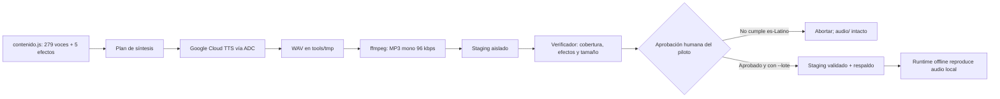

# Diseño — Generación de audio con Google Cloud TTS es-US

Modo SDD: standard  
Fase: Design  
Estado: aprobado  
Gate 1: aprobado  
Gate 2: aprobado

## Decisiones de diseño

1. **El proveedor activo será solo Google Cloud TTS.** El generador dejará de
   leer `MIMO_API_KEY` y de importar adaptadores/planes específicos de MiMo. No
   habrá fallback automático a otro proveedor: si Google falla, se aborta y se
   conserva el audio actual (Req 1.1, 1.7).
2. **Usar Application Default Credentials (ADC), no una clave MiMo ni una clave
   Google incrustada.** Para desarrollo local, la ruta recomendada es iniciar
   sesión con `gcloud auth application-default login`; se requiere un proyecto
   Google con Cloud Text-to-Speech habilitado, project/quota billing configurados,
   cuotas revisadas y facturación según las condiciones de la cuenta. Si se usa
   un archivo ADC de servicio, debe estar fuera del repositorio y nunca
   imprimirse o copiarse; ADC con credenciales de usuario es preferible para
   este flujo local.
3. **Candidatos iniciales: `es-US-Neural2-A`, `es-US-Neural2-B` y
   `es-US-Neural2-C`.** Son voces Neural2 listadas por Google para `es-US` y
   admiten el control SSML necesario para ralentizar sílabas. No asumir que
   `es-US` equivale a `es-MX`: el usuario elegirá tras escuchar el piloto. Se
   excluye `Chirp 3: HD` del piloto inicial porque su documentación indica que
   no admite SSML ni controles de speaking-rate/pitch, útiles para el modelo
   silábico.
4. **Piloto aislado de 12 clips.** Se generan cuatro textos representativos
   (letra, sílaba, palabra e instrucción/frase) para cada uno de los tres IDs
   anteriores. Se guardan WAV fuente y MP3 de escucha bajo
   `tools/tmp/google-pilot/<id>/`; el directorio `audio/` no se toca.
5. **SSML y control de velocidad inicial.** `voice.languageCode` y el nombre de
   voz deben indicar `es-US`. Se enviará SSML UTF-8 bien formado con una etiqueta
   `<prosody rate>` alrededor de la frase completa. Parámetros SSML adoptados tras
   la revisión auditiva (voz aprobada `es-US-Neural2-C`, ajustados por segunda vez
   al pedir más lentitud): `65%` para letras y sílabas sueltas, `70%` para palabras
   y `80%` para instrucciones/frases, pensando en un niño que aprende a leer.
6. **Formato de salida intermedio LINEAR16/WAV y MP3 de publicación.** El API
   devuelve bytes base64 en `audioContent`; el cliente los valida/decodifica a
   WAV y `ffmpeg` convierte a MP3 mono de 96 kbps. Este paso conserva el flujo de
   staging probado y permite inspeccionar el WAV antes de publicar (Req 1.11).
7. **Ejecuciones explícitas y con control de cuota.** El piloto requiere
   `--piloto --confirmar-costo`; el lote requiere voz aprobada, aceptación
   explícita del piloto y `--confirmar-lote`. La herramienta muestra el número
   de solicitudes antes de empezar. Los tests usan un cliente simulado y no
    realizan peticiones reales.

El inventario actual suma aproximadamente **2.746 caracteres de voz**. La tarifa
publicada por Google para Neural2 es US$16 por millón de caracteres con 1 millón
de caracteres de uso gratuito mensual sujeto a las condiciones de la cuenta;
una síntesis del lote completo representaría aproximadamente US$0,044 antes de
markup/variaciones. Este cálculo no sustituye la comprobación de billing/cuota
del proyecto antes de llamar al API.

## Arquitectura y módulos

- Runtime del juego: no cambia. HTML/JS continúa reproduciendo los MP3 incluidos;
  ninguna dependencia Google ni credencial se carga desde la aplicación.
- Generación local: `tools/generar-audios.mjs` conserva la separación entre voz,
  efectos, validación de staging y publicación, pero sustituye la integración de
  MiMo por `tools/google-tts.mjs` y `tools/plan-generacion-google.js`.
- TTS SDK: `@google-cloud/text-to-speech`, usado solo por la herramienta de
  generación. Se registra como dependencia de desarrollo para no añadir peso ni
  llamadas a red al juego.
- Auth: el cliente del SDK obtiene credenciales mediante ADC; no leerá
  `MIMO_API_KEY`, no solicitará secretos por CLI y nunca registrará access tokens.
- `tools/verificar-audios.mjs` y `tools/publicar-audios.mjs` se reutilizan para
  validar el árbol completo y hacer swap con respaldo/rollback.
- `tools/env-local.mjs`, `tools/mimo-api.mjs` y
  `tools/plan-generacion-mimo.js` dejarán de ser parte del generador tras la
  aprobación de Tasks. El `.env` ignorado y las credenciales locales no se
  eliminarán ni reescribirán automáticamente; el código dejará de leerlos.
- El piloto MiMo rechazado permanece como artefacto temporal ignorado; no se
  incluye en el juego ni se utiliza en este flujo.



## Contrato de solicitud

- SDK Google Cloud Text-to-Speech `synthesizeSpeech`, autenticación ADC y scope
  Cloud Platform. Requiere API habilitada y project/quota válidos.
- Solicitud: `input.ssml`; `voice.languageCode = "es-US"`; `voice.name` pertenece
  a la lista permitida `es-US-Neural2-A/B/C`; `audioConfig.audioEncoding =
  LINEAR16`. El WAV devuelto incluye datos de audio, no se añade una llamada de
  TTS desde el navegador.
- El contexto de pronunciación se expresa con locale, puntuación y SSML soportado;
  no se envía prompt libre ni se le pide al modelo que traduzca o reescriba texto.
  - Para unidades sueltas se conserva el texto fuente con la puntuación auxiliar
    existente; no se usa `<say-as interpret-as="characters">` en sílabas, porque
    las convertiría en lectura letra por letra.
  - La voz `es-US` interpretaba sílabas sueltas como «to» en inglés (`/tu/`); por
    eso las letras vocálicas, sílabas simples y palabras de una sílaba se envuelven
    en `<phoneme alphabet="ipa" ph="...">` con el IPA español (`to`→`to`, `tu`→`tu`,
    `cha`→`tʃa`). Las frases y textos largos se dejan sin fonema.
- Validar que `audioContent` existe y que ffmpeg puede decodificar WAV antes de
  aceptar la salida. Los errores se clasifican por auth, cuota/429, servicio,
  respuesta inválida o conversión; nunca incluyen contenido de credenciales.

## Flujo piloto y generación masiva

1. Comprobar modo explícito, ADC disponible, IDs de voz válidos y confirmación de
   cuota/costo. Sin ello no se envía ninguna solicitud.
2. Crear un identificador único, sintetizar 12 muestras y convertir cada una a
   MP3 dentro de `tools/tmp/google-pilot/<id>/<voice-id>/`.
3. El usuario escucha las muestras y confirma que el texto coincide y el acento
   sirve al público latinoamericano. Si se rechaza, no iniciar lote ni cambiar
   `audio/` (Req 1.3–1.4).
4. Con voz aceptada y confirmación explícita de lote, copiar el árbol vigente a
   un staging nuevo y sintetizar solo los 279 elementos sin `efecto`.
5. Verificar las 284 rutas requeridas, identidad byte a byte de los cinco
   efectos, decodificación de todas las salidas y tamaño del paquete inferior a
   `20,000,000` bytes (20 MB decimal).
6. Solo si todo pasa, publicar mediante `publicarStagingAudio`; conservar el
   respaldo anterior. Ante cualquier error, mantener `audio/` intacto.

```mermaid
sequenceDiagram
  participant A as Adulto
  participant G as Generador local
  participant ADC as Google ADC
  participant T as Cloud TTS es-US
  participant S as Staging
  A->>G: --piloto --confirmar-costo
  G->>ADC: Obtener credenciales locales
  G->>T: 12 solicitudes de prueba (3 voces × 4 textos)
  T-->>G: audioContent (WAV)
  G->>S: Guardar WAV/MP3 sin tocar audio/
  A->>A: Escuchar y aprobar/rechazar
  alt muestra rechazada
    G-->>A: Detener; los audios actuales siguen intactos
  else muestra aprobada + --lote --confirmar-lote
    G->>T: Sintetizar 279 audios hablados
    T-->>G: WAV por solicitud
    G->>S: Convertir y validar cobertura/efectos/tamaño
    G->>G: Publicar staging con respaldo/rollback
  end
```

## Errores y seguridad

| Situación | Manejo |
|---|---|
| ADC ausente o proyecto sin API habilitada | Fallar antes de sintetizar; explicar configuración local sin mostrar archivos o tokens. |
| Cuota agotada, facturación o 429 | Detener lote y conservar staging parcial para diagnóstico; no publicar ni reintentar automáticamente. |
| Texto/SSML inválido o voz no disponible | Fallar la solicitud con índice/ruta de contenido, sin incluir credenciales; no publicar. |
| Respuesta sin WAV o conversión ffmpeg fallida | Rechazar salida y mantener `audio/` actual. |
| Lote supera 20,000,000 bytes o faltan rutas | No hacer swap; informar conteos. |
| Swap/publicación falla | Restaurar respaldo con el helper transaccional existente. |

Las credenciales de ADC no se guardan bajo el repositorio; las credenciales de
usuario no se imprimen. El API recibe textos de contenido estático del juego,
sin perfil ni nombre privado de niños. El `.env` local antiguo no se leerá ni se
modificará durante esta integración.

## Pruebas, invariantes y quality-bar

- **Estrategia:** TDD focalizado con `node:test` para configuración, mapping
  `{texto, voz, locale}`, SSML, decodificación, manejo de errores, staging y
  rollback. Todos los tests usan un cliente inyectado/mocked; ninguno contacta a
  Google ni requiere ADC real.
- **Revisión manual:** el usuario escucha el piloto en el reproductor del sistema
  y aprueba idioma/acento, dicción, ritmo, fidelidad textual y consistencia. Los
  tests automáticos no certifican calidad de acento.
- Al cerrar implementación: `npm test`, `npm run verificar`, prueba `file://` sin
  red, hash de efectos sin cambios y tamaño del juego por debajo de 20,000,000 bytes.
- No se añade PBT: la generación es integración externa/sonora, no una propiedad
  algebraica.
- Invariantes críticos: (1) sólo locale `es-US` y voz permitida en cada request;
  (2) todos los textos salen del inventario sin reformularse; (3) el runtime no
  hace llamadas a Google; (4) los efectos no cambian; (5) el staging no se publica
  con una falla o sin aprobación del piloto.
- **Capas/DI:** el SDK vive solo en `tools/`; cliente y convertidor son
  dependencias inyectables de las funciones de generación; no se introduce un
  singleton en el runtime ni abstracciones adicionales en dominio/UI.
- **Errores:** el adaptador de infraestructura traduce errores de Google a
  mensajes sin secretos; la orquestación detiene el proceso, no hace `catch`
  vacío y preserva audios activos.
- No se identifican excepciones al quality-bar en esta fase.

## Trazabilidad

| Requisito | Decisión / componente |
|---|---|
| Req 1.1 | SDK Google, allowlist `es-US-Neural2-*`, voz única por lote |
| Req 1.2–1.4 | Piloto de 12 WAV/MP3 aislados y revisión auditiva bloqueante |
| Req 1.5–1.6 | Inventario actual, preservar efectos y swap con respaldo |
| Req 1.7–1.9 | Errores de ADC/cuota, flags de confirmación y secretos solo locales |
| Req 1.10–1.11 | Runtime estático offline y verificación 284 rutas/20 MB |

## Fuentes oficiales

- [Voces Google Cloud TTS (lista actual)](https://docs.cloud.google.com/text-to-speech/docs/list-voices-and-types)
- [SSML en Google Cloud TTS](https://cloud.google.com/text-to-speech/docs/ssml)
- [REST `text.synthesize`](https://cloud.google.com/text-to-speech/docs/reference/rest/v1/text/synthesize)
- [Quickstart Node.js: Text-to-Speech](https://cloud.google.com/text-to-speech/docs/create-audio-text-client-libraries)
- [Application Default Credentials](https://cloud.google.com/docs/authentication/application-default-credentials)
- [Precio y cuota](https://cloud.google.com/text-to-speech/pricing)
