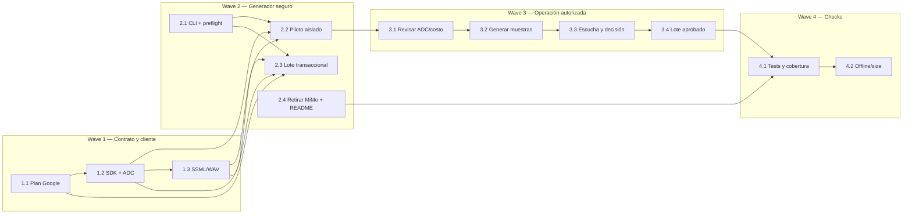

# Tareas — Generación de audio con Google Cloud TTS es-US

Modo SDD: standard  
Fase: Completada  
Estado: cerrada  
Gate 1: aprobado  
Gate 2: aprobado  
Gate 3: aprobado  
Gate 4: aprobado

## Convenciones

- Pruebas: **TDD focalizado** con `node:test`; cada tarea de comportamiento sigue
  RED → GREEN mínimo → REFACTOR si aporta valor.
- Ningún test podrá usar ADC del usuario ni llamar a Google Cloud. El cliente SDK
  se inyecta/simula en las pruebas para evitar que `npm test` cause cargos o use
  credenciales locales.
- Las llamadas reales quedan en las tareas 3.x, después de Gate 3 y de confirmar
  proyecto, facturación/cuota y el costo.
- Nunca se escribe audio nuevo en `audio/` hasta que un lote completo haya pasado
  validación; ningún lote se inicia si el usuario no aprueba el piloto.
- No borrar/modificar `.env` ni los temporales ignorados del piloto MiMo; el nuevo
  generador simplemente no leerá ni invocará código MiMo.

## Wave 1 — Cliente y plan determinista

- [x] **1.1 [TDD focalizado] Plan de muestras y lote Google** (Req 1.1, 1.2,
  1.5): RED para detectar conteo, rutas, texto fuente, allowlist de voz y locale
  incorrectos → GREEN en `tools/plan-generacion-google.js` para 12 muestras
  (`es-US-Neural2-A/B/C` × letra/sílaba/palabra/instrucción) y 279 audios hablados
  de lote → REFACTOR solo si reduce duplicación real.
- Evidencia: `node --test tests/plan-generacion-google.test.js` — RED observado
  al no existir el módulo; GREEN con 5/5 tests de plan, locale, texto y SSML.
- [x] **1.2 [P] [TDD focalizado] Adaptador Google Cloud TTS** (Req 1.1, 1.7,
  1.9): RED para solicitud `input.ssml`, voz es-US válida, salida LINEAR16 y
  errores de ADC/API → GREEN en `tools/google-tts.mjs` con cliente inyectable
  basado en `@google-cloud/text-to-speech` → REFACTOR solo si aclara el límite de
  infraestructura. Tests sin red y sin ADC real.
- Evidencia: `node --test tests/google-tts.test.js` — RED observado con adaptador
  sin implementar; GREEN con 7/7 pruebas usando cliente simulado, sin red/ADC.
- [x] **1.3 [P] [TDD focalizado] Normalización SSML y validación WAV** (Req 1.1,
  1.2, 1.7): RED para texto/escapado inválidos y bytes de salida no decodificables
  → GREEN conservando texto y aplicando solo SSML permitido; rechazo de respuesta
  inválida antes de escribir a disco.
- Evidencia: `node --test tests/plan-generacion-google.test.js tests/google-tts.test.js`
  — GREEN con 12/12 pruebas; cubre XML escaping, rate allowlist y RIFF/WAVE.

## Wave 2 — Generación segura y retirada del adaptador MiMo

- [x] **2.1 [TDD focalizado] CLI de modos y preflight ADC/costo** (Req 1.7–1.9):
  RED para impedir piloto sin confirmación, lote sin aprobación del piloto y
  credencial/proyecto ausente → GREEN con `--piloto --confirmar-costo` y
  `--lote --voz <voice-id> --acepto-piloto --confirmar-lote`; los tests usan un
  directorio/env aislados, aunque exista ADC real en la máquina.
- Evidencia: `node --test tests/generar-audios-google.test.js` — RED observado
  contra la CLI MiMo; GREEN con validación de flags/confirmación y bloqueo antes
  de ADC si falta `--confirmar-costo` (7/7 tests de flujo).
- [x] **2.2 [TDD focalizado] Piloto en staging** (Req 1.2–1.4, 1.7): RED para
  demostrar que los archivos activos no cambian si falla una petición → GREEN
  para guardar 12 WAV/MP3 bajo `tools/tmp/google-pilot/<id>/<voice-id>/`; no
  modificar `audio/` y entregar una guía con locale, ID de voz y texto leído.
- Evidencia: `node --test tests/generar-audios-google.test.js` — 12 llamadas
  simuladas escriben exclusivamente staging; archivo activo permanece idéntico.
- [x] **2.3 [TDD focalizado] Lote completo transaccional** (Req 1.5–1.7, 1.11):
  RED para una respuesta/API/conversión fallida y para efectos alterados → GREEN
  para copiar audio actual a staging, sintetizar solo las 279 pistas habladas,
  validar 284 rutas y cinco efectos, límite de 20,000,000 bytes y publicar con el
  helper transaccional existente; mantener backup para rollback.
- Evidencia: `node --test tests/generar-audios-google.test.js` — GREEN con 279
  salidas simuladas, cobertura/efectos y backup; fallo API deja el audio activo
  intacto.
- [x] **2.4 Retirar la integración MiMo y documentar Google** (Req 1.1, 1.9,
  1.10): eliminar adaptador/plan/loader/tests MiMo del código activo, actualizar
  README con ADC y billing/costos Google y añadir `@google-cloud/text-to-speech`
  como dependencia usada por herramientas de generación (no runtime). No editar
  `.env` local ni eliminar los pilotos temporales.
- Evidencia: README Google/ADC actualizado; dependencias SDK/Auth están en
  `devDependencies`; adaptadores/tests MiMo retirados del código activo. `npm test`
  pasó 97/97, `npm run verificar` 284/284 y la construcción local del SDK no hizo
  solicitud TTS.

## Wave 3 — Piloto real y decisión auditiva

- [x] **3.1 Preflight de ejecución externa** (Req 1.7–1.9): comprobar ADC y
  proyecto/servicio habilitado sin imprimir credenciales; presentar 12 solicitudes
  previstas y requerir confirmación de cuota/facturación/costo antes de invocar
  Google Cloud.
- Evidencia: ADC válido y proyecto `fur-openclaw-blogger`; se corrigió el proyecto
  de cuota de ADC (antes `testing-f7dc2`) y se habilitó `texttospeech.googleapis.com`
  en el proyecto correcto. Prueba de humo de 1 palabra devolvió 24.764 bytes WAV.
  No se modificó `.env` ni el audio del juego.
- [x] **3.2 Ejecutar el piloto Google** (Req 1.2): llamar el API solo después de
  completar 3.1; almacenar las muestras en staging y validar que WAV/MP3 se
  decodifican. No reemplazar audios activos.
- Evidencia: `tools/tmp/google-pilot/2026-10-08T03-14-49-307Z/` con 3 voces × 4
  textos; 12 WAV + 12 MP3 decodifican sin error con ffmpeg y `npm run verificar`
  sigue en 284/284. Ningún archivo de `audio/` fue modificado.
- [x] **3.3 Revisión auditiva del usuario** (Req 1.3, 1.4): evaluar locale/acento,
  pronunciación, inteligibilidad, texto exacto y ritmo; si se rechaza, documentar
  bloqueo, conservar los MP3 actuales y detenerse antes de 3.4.
- Resultado: el usuario aprueba la voz `es-US-Neural2-C` y pide reducir la
  velocidad. Se ajustaron los rates a `75%` (letra/sílaba), `80%` (palabra) y
  `90%` (instrucción/frase), se generó muestra lenta
  (`tools/tmp/google-pilot-slow/es-US-Neural2-C/`) y el usuario autorizó el lote.
- [x] **3.4 Generar el lote aprobado** (Req 1.5–1.7, 1.11): usar una sola voz
  Neural2 aprobada, generar las 279 pistas a staging y publicar solo tras pasar
  validación completa de rutas, efectos y tamaño.
- Evidencia: comando de lote con `es-US-Neural2-C` completó 279/279; verificador
  `284 · 0 faltantes`; tamaño `4.04 MB`; respaldo en
  `tools/tmp/google-backup/audio-2026-10-08T03-30-32-008Z/`; efectos byte a byte
  idénticos al respaldo.

## Wave 4 — Cierre técnico de implementación

- [x] **4.1 Pruebas de código y cobertura de audio** (Req 1.1–1.11): ejecutar
  `npm test` y `npm run verificar`; asegurar que tests no llamen a Google y que
  el inventario activo siga en 284 rutas sin faltantes ni sobrantes.
- Evidencia: `npm test` 97/97 (sin llamadas reales; clientes inyectados) y
  `npm run verificar` 284/284 con 0 sobrantes.
- [x] **4.2 Comprobación offline y tamaño** (Req 1.6, 1.10, 1.11): reproducción
  manual desde `file://` sin red, efectos byte por byte iguales, no hay referencias
  a credenciales/requests Google en `index.html`, `css/` o `js/`, paquete `<20 MB`.
- Evidencia: `rg "googleapis|GOOGLE_|texttospeech|API_KEY" index.html css js` → 0;
  efectos `cmp` idénticos; paquete 4.04 MB (<20 MB). Queda como paso humano la
  escucha final del juego abierto con `file://` sin red.
- [omitido: PBT no aplica; las integraciones externas/audio y sus criterios no
  forman una propiedad algebraica que justifique PBT.]

## Post-cierre — ajustes pedidos por el usuario

- [x] Bugfix: al pulsar «siguiente» la carretilla/cuento repetían el ejercicio.
  `js/ui/pantallas/actividad.js` ahora cierra el ejercicio (`sesion.completar()`)
  antes de avanzar. Regresión en `tests/integracion-ui.test.js`.
- [x] Bugfix: retocar fichas apilaba botones «siguiente». La carretilla avisa una
  sola vez (`js/ui/actividades/carretilla.js`) y la pantalla no duplica el botón.
- [x] Bugfix: la felicitación se cortaba por un `esperar(650)` fijo antes de
  mostrar el ejercicio siguiente. Ahora se espera a que termine el audio real
  (`await reproducir(...)`) más 250 ms de respiro.
- [x] Ajuste: velocidad más lenta `65%`/`70%`/`80%`; lote de 279 pistas
  regenerado y publicado (respaldo `tools/tmp/google-backup/audio-2026-10-08T03-51-30-574Z/`).
- [x] Bugfix: la pista no repetía el sonido modelo (Req 5.3). Ahora al resaltar
  la opción correcta reproduce `instr/pista` **y** el modelo del ejercicio.
  Regresión en `tests/integracion-ui.test.js` (RED verificado revirtiendo el
  arreglo, GREEN restaurado).
- [x] Bugfix: la voz `es-US` leía sílabas sueltas como «to» en inglés (`/tu/`).
  Ahora las letras/sílabas/palabras de una sola sílaba se fuerzan a IPA español
  con `<phoneme>` (`tools/plan-generacion-google.js::fonemaDe`); el resto se
  sintetiza normal. Lote regenerado
  (respaldo `tools/tmp/google-backup/audio-2026-10-08T04-11-19-493Z/`).
- [x] Bugfix: en «arma la palabra» la sílaba elegida no se marcaba porque
  `ctx.responder` es asíncrono y se leía su resultado como inmediato. Ahora la
  sílaba correcta se coloca al instante (`hueco.lleno`, ficha `usada`); la
  incorrecta solo se sacude y suena el error. Regresión en
  `tests/integracion-ui.test.js` (RED reproducido con script de simulación).
- [x] Contenido: felicitaciones ampliadas a 15 (`correcto-1`..`correcto-15`, 6 con
  variantes m/f/n) en `js/datos/contenido.js`. Nuevos audios generados con
  `es-US-Neural2-C`; inventario pasa a 298 pistas de voz + 5 efectos (303).
  Obsoletos `correcto-2-*`/`correcto-3-*` eliminados (respaldo
  `tools/tmp/google-backup/audio-2026-10-08T04-20-18-837Z/`).
- Verificación: `npm test` 104/104; `npm run verificar` 303 · 0 · 0; efectos
  intactos; 0 audios no decodificables.

## Grafo de waves

