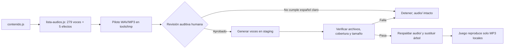

# Diseño — Mejora de calidad de audio con MiMo TTS

Modo SDD: standard  
Fase: Design  
Estado: sustituido por la evaluación Google Cloud TTS es-US  
Gate 1: aprobado  
Gate 2: aprobado

## Decisiones de diseño

1. **MiMo solo genera archivos durante el desarrollo.** El navegador sigue
   reproduciendo MP3 locales; no se agregan llamadas a red, claves ni dependencias
   de MiMo al juego. Esto conserva el uso con `file://` y sin conexión (Req 1.8,
   Req 1.9).
2. **Se prueba primero `mimo-v2.5-tts` con voz predefinida.** Es la opción de la
   familia orientada a síntesis con voz fija. No se propone VoiceDesign ni
   VoiceClone: no hay una muestra autorizada y el objetivo requiere la misma
   identidad de voz en cientos de clips.
3. **No se considera confirmado el español.** El material oficial consultado
   enumera voces predefinidas chinas e inglesas, no español. Antes del lote se
   generará un piloto separado con las cuatro voces predefinidas inglesas
   (`Mia`, `Chloe`, `Milo`, `Dean`) leyendo textos españoles representativos. Solo
   se continuará con una voz si el usuario escucha y aprueba su dicción en
   español latinoamericano. Si ninguna sirve, se conserva el lote actual y se
   informa el bloqueo; no se cambia silenciosamente de proveedor.
4. **Una instrucción de estilo común.** El candidato para `context` es:

   > Lee exactamente el texto, en español latinoamericano neutro, con una sola
   > voz adulta cálida, amable y clara. Articula con precisión, en un ritmo
   > pausado y natural, con una breve separación entre letra, sílaba y palabra.
   > No añadas, omitas ni reformules palabras; no uses música ni efectos y evita
   > la dramatización, los susurros y las muletillas.

   Se enviará el texto original como contenido a sintetizar; el contexto no
   modifica los textos educativos. La instrucción es experimental, no una
   garantía de soporte lingüístico.
5. **Conservar la salida local MP3 y elevar la calidad de codificación.** MiMo
   devuelve WAV en el ejemplo oficial. El piloto se guardará como WAV y como MP3
   mono de 96 kbps para escuchar la versión que consumiría el juego. El bitrate
   final podrá ajustarse en el piloto; el límite existente de 20 MB manda sobre
   cualquier aumento de calidad que no quepa en el paquete (Req 1.10).
6. **Evitar ejecuciones accidentales.** El CLI exige `--piloto --confirmar-costo`
   para las muestras y `--lote --voz <voz> --acepto-piloto --confirmar-lote`
   para el lote. Cada staging usa un identificador de ejecución único; un staging
   preexistente no se borra ni sobrescribe.

## Componentes y flujo

- `tools/lista-audios.js` sigue siendo la fuente del inventario: actualmente
  devuelve **279 audios hablados y 5 efectos**.
- `tools/generar-audios.mjs` seguirá orquestando la generación y separará
  explícitamente voz de efectos. No se enviarán al proveedor los 5 efectos ni
  audios ya incluidos como efectos.
- Un adaptador acotado de MiMo dentro de las herramientas de generación enviará
  las peticiones desde Node (Node 20 ya es requisito del proyecto) al endpoint
  oficial `https://api.xiaomimimo.com/v1`, usando el contrato de chat-completions
  mostrado por la integración oficial Xiaomi. Leerá `MIMO_API_KEY` solo del
  entorno local. No se necesita una nueva dependencia en tiempo de juego.
- `ffmpeg` convertirá los WAV a MP3 mono. Se mantendrá la puntuación auxiliar
  actualmente aplicada a letras, sílabas y palabras sueltas; no se dará por
  equivalente el parámetro Piper `length_scale`, ya que MiMo se controla con
  instrucciones de estilo y no se documenta aquí un control numérico de velocidad.
- El verificador podrá comprobar una raíz de audio indicada por argumento para
  validar un árbol de staging, además de la carpeta normal `audio/`.

## Contrato de petición y configuración

- Endpoint y autenticación: `https://token-plan-sgp.xiaomimimo.com/v1` y `Authorization`
  obtenida de `MIMO_API_KEY`, leída del entorno del proceso o del archivo local
  `.env` (el entorno del proceso tiene prioridad). El cargador de `.env` solo
  admite esa clave y nunca registra su valor; `.env` está excluido de Git.
- Solicitud: modelo `mimo-v2.5-tts`, contexto de estilo como mensaje `user`, texto
  fuente como mensaje `assistant`, y `audio: { format: "wav", voice: <voz> }`.
- La voz se mantendrá fija para todo el lote, incluidas las variantes de texto
  masculino/femenino/neutro. La selección final depende del piloto; no se asigna
  una voz española inexistente en la lista oficial.
- El cliente comprobará estado HTTP, estructura y existencia del audio devuelto
  antes de escribir el WAV. Errores de autenticación, cuota, respuesta inválida
  o red deben identificar la operación sin imprimir secretos.
- Se ejecutará el lote de forma secuencial inicialmente, dado que no se confirmó
  un límite de concurrencia público. Los 279 audios implican hasta 279 peticiones
  en el lote completo; antes de iniciarlo se comprobarán la cuota y las
  condiciones de uso/costo disponibles en la cuenta.

## Staging, sustitución y recuperación

1. El piloto se escribe bajo `tools/tmp/mimo-pilot/` y nunca bajo `audio/`.
2. Tras la aprobación del piloto, se copia el árbol `audio/` completo a
   `tools/tmp/mimo-build/audio/`; así se preservan los efectos y archivos ajenos
   a la voz. Los MP3 hablados nuevos se escriben solo en esa copia.
3. Se valida cobertura completa de las 279 rutas habladas, que los 5 efectos
   siguen byte por byte iguales, que cada salida es MP3 legible y que el tamaño
   queda bajo 20 MB. Si una petición o validación falla, no se toca `audio/`.
4. Solo tras validar el lote se renombra el árbol vigente a una copia de respaldo
   dentro de `tools/tmp/` y el staging a `audio/`. Si el segundo renombrado falla,
   se restaura el árbol anterior. Se conserva el respaldo tras una sustitución
   correcta para permitir revertirla manualmente.

Esta transacción evita que `--forzar` deje una mezcla de voces si falla una
petición a mitad del lote. Las carpetas `tools/tmp/` ya están ignoradas por Git.

## Errores

| Situación | Manejo |
|---|---|
| `MIMO_API_KEY` ausente | Fallar antes de iniciar peticiones, indicar cómo configurar el entorno; no modificar audios. |
| HTTP no exitoso, límite o desconexión | Informar el tipo de operación y dejar el staging incompleto; mantener `audio/` intacto. |
| Respuesta sin audio WAV válido o conversión fallida | Rechazar el archivo, abortar la publicación del lote y conservar `audio/`. |
| Piloto con pronunciación o acento inadecuados | No iniciar lote completo; conservar audios actuales. |
| Error al sustituir el árbol de audio | Restaurar el respaldo antes de informar el fallo. |

## Pruebas y verificación

- **Estrategia:** TDD focalizado para el comportamiento nuevo de generación,
  staging y publicación; no TDD estricto. Cada tarea de comportamiento tendrá
  RED → GREEN → REFACTOR, y el test RED deberá fallar por el criterio correcto.
- Con `node:test`, cubrir el mapeo de voz/texto/contexto, decodificación de
  respuesta, tratamiento de errores, exclusión de efectos, no sobrescritura ante
  error y rollback del renombrado. Los tests no llaman a la API real ni requieren
  `MIMO_API_KEY`.
- La calidad lingüística no se puede certificar con tests unitarios: requiere
  escuchar el piloto en un reproductor real y evaluar español latinoamericano,
  nombres de letras, sílabas, acentos, inteligibilidad y consistencia de voz.
- Tras el lote: `npm test`, `npm run verificar`, reproducción offline desde
  `file://`, comparación byte por byte de los efectos y tamaño total inferior a
  20 MB.
- No se añade PBT: el problema es de integración/audio y no tiene una propiedad
  algebraica que justifique una dependencia adicional.

## Trazabilidad

| Requisito | Decisión / componente |
|---|---|
| Req 1.1–1.2 | Modelo MiMo fijo, prompt común y escucha del piloto |
| Req 1.3–1.4 | Piloto separado y bloqueo previo al lote |
| Req 1.5–1.6 | Inventario `lista-audios.js`; solo voz regenerada, efectos preservados |
| Req 1.7 | Staging, validación antes de publicar y rollback |
| Req 1.8–1.9 | API solo en herramientas locales; credencial ambiental; juego estático offline |
| Req 1.10 | Verificador sobre staging, cobertura y límite de 20 MB |

## Quality-bar y excepciones

- Capas: la UI y el dominio no conocen la API; toda integración externa queda en
  `tools/`, fuera del runtime del juego.
- Inyección: el generador entrega el acceso HTTP a una función pequeña testeable;
  no se introduce un contenedor ni un singleton compartido con la aplicación.
- Errores: los errores de API, conversión y publicación se distinguen y reportan;
  no hay `catch` vacío.
- Sin excepciones al quality-bar identificadas en esta fase.

## Fuentes

- [Xiaomi MiMo-V2.5-TTS Series](https://mimo.xiaomi.com/mimo-v2-5-tts)
- [Skill oficial XiaomiMiMo](https://github.com/XiaomiMiMo/MiMo-Skills/blob/main/skills/mimo-v2-5-tts/SKILL.md)
- [Guía de síntesis de voz MiMo-V2.5](https://platform.xiaomimimo.com/docs/usage-guide/speech-synthesis-v2.5)
