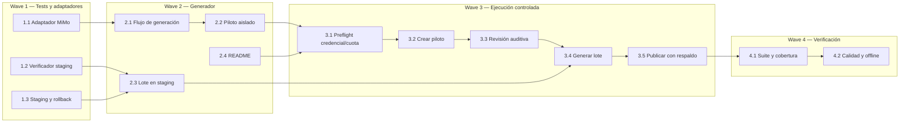

# Tareas — Mejora de calidad de audio con MiMo TTS

Modo SDD: standard  
Fase: sustituida  
Estado: cancelada por cambio de proveedor solicitado por el usuario  
Gate 1: aprobado  
Gate 2: aprobado  
Gate 3: aprobado

> No ejecutar el lote MiMo. El piloto fue rechazado por acento no latinoamericano;
> el alcance vigente continúa en `.sdd/specs/audio-calidad-google-esus/`.

## Convenciones

- Pruebas: **TDD focalizado** con `node:test`; toda tarea de comportamiento sigue
  RED → GREEN mínimo → REFACTOR si aporta valor.
- Las pruebas automatizadas no llamarán a MiMo ni necesitan `MIMO_API_KEY`.
- El piloto usa `tools/tmp/mimo-pilot/` y no modifica `audio/`. El lote completo
  no empieza hasta que el usuario haya escuchado y aprobado el piloto, como exigen
  Req 1.3–1.4.
- Si falta clave, cuota disponible, soporte práctico de español o autorización
  para cualquier costo aplicable, se detiene la generación sin reemplazar archivos.

## Wave 1 — Adaptadores seguros y tests

- [x] **1.1 [TDD focalizado] Adaptador de MiMo** (Req 1.1, 1.2, 1.7, 1.9): RED
  para petición correcta, lectura de `MIMO_API_KEY`, decodificación de audio y
  manejo de respuesta/HTTP inválido → GREEN en un módulo pequeño de herramientas
  con `fetch` inyectable → REFACTOR solo si simplifica responsabilidades.
- Evidencia: `node --test tests/mimo-api.test.js` — RED observado con 4 fallos
  por comportamiento aún no implementado; GREEN con 4/4 tests funcionales.
- [x] **1.2 [P] [TDD focalizado] Verificador de raíz configurable** (Req 1.5,
  1.10): RED para verificar cobertura desde un directorio de staging → GREEN en
  `tools/verificar-audios.mjs` sin cambiar el uso normal de `audio/` → REFACTOR
  solo si aporta valor.
- Evidencia: `node --test tests/verificar-audios.test.js` — RED observado al
  ignorar `--raiz`; GREEN con 3/3 tests para árbol vacío, completo y sobrantes.
- [x] **1.3 [P] [TDD focalizado] Preparación/publicación transaccional** (Req 1.3,
  1.4, 1.6, 1.7): RED para demostrar que un fallo no altera `audio/`, que los
  efectos se conservan y que se restaura el respaldo si falla el cambio de árbol
  → GREEN con staging y rollback → REFACTOR solo si aclara el flujo.
- Evidencia: `node --test tests/publicar-audios.test.js` — RED observado con
  cuatro fallos antes de implementación; GREEN con 5/5 tests, incluyendo rollback
  y protección contra sobrescribir un staging preexistente.

## Wave 2 — Generador MiMo

- [x] **2.1 [TDD focalizado] Generador de voz y selección de muestras** (Req 1.1,
  1.2, 1.5, 1.6): RED para confirmar que solo se envían entradas habladas, se
  conserva el texto fuente y se aplica la misma instrucción de estilo → GREEN en
  `tools/generar-audios.mjs` usando el adaptador; no se llama al API desde tests.
- Evidencia: `node --test tests/plan-generacion-mimo.test.js` — RED observado
  antes de implementar el plan; GREEN con 4/4 tests.
- [x] **2.2 [TDD focalizado] Salida aislada del piloto** (Req 1.3, 1.4): RED para
  requerir WAV/MP3 separados por voz y tipo de texto y probar que no se toca
  `audio/` → GREEN con 16 clips (4 voces predefinidas inglesas × letra, sílaba,
  palabra e instrucción/frase) bajo `tools/tmp/mimo-pilot/` → REFACTOR si mejora
  claridad sin introducir capas innecesarias.
- Evidencia: `node --test tests/generar-audios.test.js` — RED observado en los
  dos comportamientos del piloto; GREEN en los tests de 16 muestras y fallo seguro.
- [x] **2.3 [TDD focalizado] Lote completo a staging** (Req 1.5–1.7, 1.10): RED
  para abortar ante fallo parcial y mantener los archivos actuales → GREEN para
  generar las 279 voces al árbol preparado, conservar intactos los 5 efectos,
  validar cobertura/tamaño y publicar con respaldo solo al completar todo.
- Evidencia: `node --test tests/generar-audios.test.js` — RED observado en los
  dos comportamientos de lote; GREEN en publicación completa y fallo de API sin
  reemplazar `audio/`.
- [x] **2.4 Documentar uso local** (Req 1.8, 1.9): actualizar `README.md` con
  instalación/configuración de la generación MiMo, variable de entorno, comandos
  de piloto y lote, funcionamiento offline del juego y manejo del respaldo. No
  documentar ni copiar claves reales.
- Evidencia: `README.md` actualizado con comandos, condiciones y restricciones de
  generación MiMo.

## Wave 3 — Prueba auditiva y regeneración

- [x] **3.1 Preflight local de generación** (Req 1.7, 1.9): comprobar que la
  variable existe sin imprimirla; mostrar cantidad de solicitudes antes de un
  lote y confirmar que la cuenta/cuota permite el uso previsto. Si hay un costo
  no cubierto por la cuota disponible, parar y pedir autorización antes de enviar
  ese lote.
- Evidencia: clave leída de `.env` (estado de presencia comprobado sin imprimirla),
  endpoint `token-plan-sgp.xiaomimimo.com/v1`, confirmación del usuario para
  iniciar el piloto y 16 solicitudes previstas. `.env` está excluido de Git.
- [x] **3.2 Generar y entregar el piloto** (Req 1.3): ejecutar el comando de
  piloto solo si hay credencial y cuota disponibles; informar rutas de los WAV y
  MP3. No hacer todavía llamadas para las 279 voces.
- Evidencia: `tools/tmp/mimo-pilot/2026-10-01T20-13-17-057Z/` contiene cuatro
  WAV y cuatro MP3 por cada voz candidata (16 de cada formato); ffmpeg decodifica
  correctamente los 32 archivos. `README.txt` en la carpeta identifica el texto
  de cada clip.
- [x] **3.3 Revisión auditiva del usuario** (Req 1.2, 1.4): escuchar las muestras
  y comprobar acento latinoamericano, articulación de letras/sílabas, fidelidad
  textual, inteligibilidad y consistencia. Si no cumple, registrar el bloqueo y
  conservar los MP3 actuales; no continuar a 3.4.
- En espera del usuario: `tools/tmp/mimo-pilot/2026-10-01T20-13-17-057Z/`
  contiene `Mia/`, `Chloe/`, `Milo/` y `Dean/`, cada una con `letra.mp3`,
  `silaba.mp3`, `palabra.mp3` e `instruccion.mp3`; guía en `README.txt`.
- Resultado: usuario confirma que las voces no suenan a español latinoamericano.
  Piloto rechazado; por Req 1.4 no generar el lote completo ni reemplazar `audio/`
  hasta encontrar una voz/configuración con soporte adecuado y aprobar una nueva
  muestra.
- [ ] **3.4 Generar lote aprobado** (Req 1.5–1.7, 1.10): usar exclusivamente la
  voz aprobada para las 279 pistas; generar en staging, convertir a MP3 mono y
  validar los archivos y el tamaño antes de publicar.
- [ ] **3.5 Publicar con recuperación** (Req 1.6–1.7): comprobar identidad de
  los efectos, respaldar `audio/`, sustituir el árbol validado y probar rollback
  ante fallo. Mantener el respaldo en `tools/tmp/` tras una sustitución correcta.

## Wave 4 — Verificación

- [ ] **4.1 Suite y cobertura** (Req 1.5, 1.7, 1.10): ejecutar `npm test`,
  `npm run verificar` y revisar que se esperan 279 pistas de voz y 5 efectos sin
  faltantes.
- [ ] **4.2 Revisión de calidad y restricciones** (Req 1.2, 1.6, 1.8–1.10):
  spot-check auditivo de pistas generadas, prueba manual desde `file://` sin red,
  confirmar que el reproductor no hace peticiones externas, que los efectos no
  cambiaron y que el tamaño del paquete es menor de 20 MB.
- [omitido: PBT no aplica; la integración de API y la evaluación de calidad de voz
  no tienen una propiedad algebraica que justifique PBT.]

## Grafo de waves

