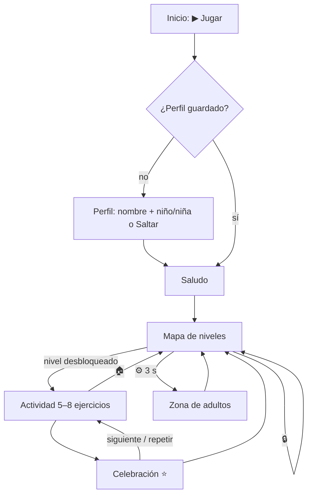
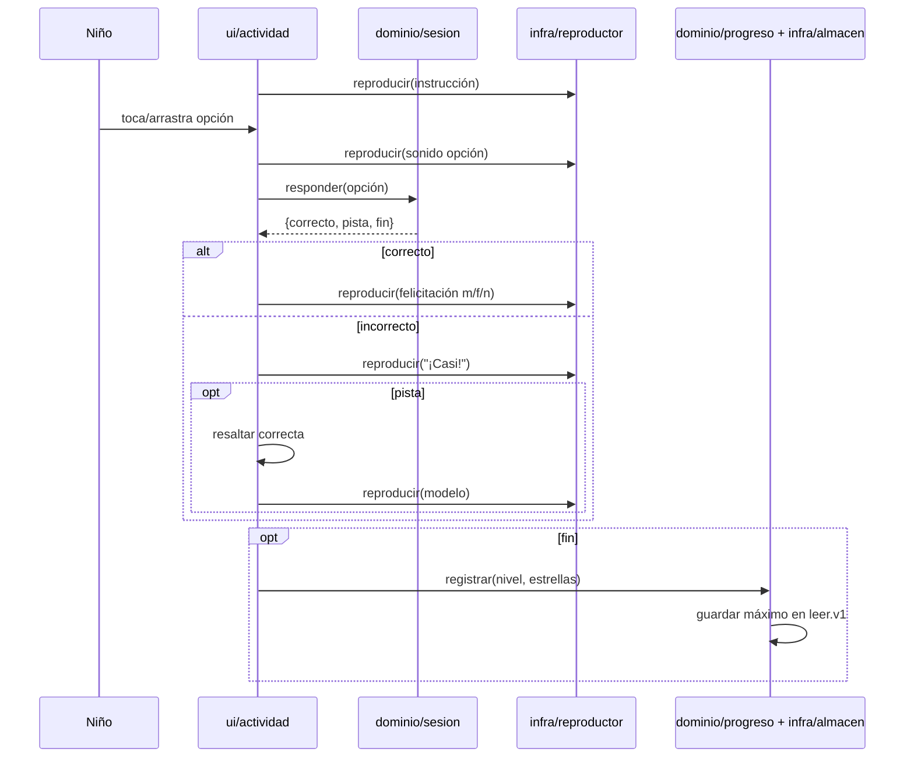

# Diseño — Juego para aprender a leer

Modo SDD: standard
Fase: Design
Estado: aprobado
Gate 2: aprobado

## Contexto y supuestos
- Proyecto nuevo, sin código ni steering previo. Stack: HTML + CSS + JavaScript sin frameworks ni dependencias en tiempo de ejecución.
- Se abre con doble clic en `index.html` (protocolo `file://`). Esto condiciona el diseño:
  - Chrome bloquea `<script type="module">` y `fetch()` en `file://` → se usan **scripts clásicos** que registran sus piezas en un espacio de nombres global `LEER`, y los datos van en `.js`, no en `.json`.
  - `<audio src="audio/...mp3">` con ruta relativa sí funciona en `file://`.
- Voz: **Piper TTS**, voz `es_MX-claude-high` (dataset Apache-2.0). Respaldo: `es_MX-ald-medium` (Unlicense). Solo se usa en la máquina del adulto para generar los MP3; el juego no depende de Piper.
- Herramientas locales verificadas: Node 25, Python 3.12 y ffmpeg. Piper no está instalado; se instalará en un entorno virtual con versión fijada (`piper-tts==1.3.0`, a confirmar al implementar).
- Imágenes: emoji del sistema. No hay descargas y funciona offline, aunque el dibujo cambia según el dispositivo.

## Arquitectura (capas)

```
index.html  →  ui/*  →  dominio/*  ←  datos/contenido.js
                 ↓
              infra/*   (localStorage, <audio>, speechSynthesis)
app.js = composition root (crea instancias e inyecta dependencias)
```

- **datos**: solo contenido declarativo (niveles, palabras, frases, cuentos y textos de instrucciones con variantes de género).
- **dominio**: lógica pura sin DOM ni APIs del navegador; se prueba en Node.
- **infra**: adaptadores; es la única capa que toca `localStorage`, `Audio` y `speechSynthesis`.
- **ui**: pantallas y renderizado; recibe servicios por parámetro. Usa `textContent`, nunca `innerHTML` con datos variables (Req 9.10).
- Cada archivo de dominio termina con `if (typeof module !== 'undefined') module.exports = …` para poder hacer `require` desde los tests de Node.

## Componentes / módulos

```
LEER/
├── index.html
├── css/estilos.css
├── js/
│   ├── datos/contenido.js      # niveles, palabras, frases, cuentos, instrucciones
│   ├── dominio/claves-audio.js # texto → ruta mp3 (slug estable, sin tildes ni ñ en el nombre de archivo)
│   ├── dominio/perfil.js       # validar nombre; elegir variante m/f/n
│   ├── dominio/progreso.js     # desbloqueo, estrellas, fusión con lo guardado
│   ├── dominio/sesion.js       # genera ejercicios del nivel, intentos, pista tras 2 fallos
│   ├── infra/almacen.js        # único acceso a localStorage (clave versionada, parse seguro)
│   ├── infra/reproductor.js    # un solo canal de audio, cola, volumen, tolera 404
│   ├── infra/voz-nombre.js     # speechSynthesis es-* para el nombre
│   ├── ui/pantallas/*.js       # inicio, perfil, mapa, actividad, celebración, adultos
│   ├── ui/actividades/*.js     # escucha-elige, une-letras, carretilla, arma-palabra, lee-elige, cuento
│   └── app.js                  # composition root + enrutado de pantallas
├── audio/                      # generado: vocales/, silabas/, palabras/, frases/, instr/, efectos/
├── tools/
│   ├── lista-audios.js         # contenido → lista {texto, ruta}
│   ├── generar-audios.mjs      # llama a piper + ffmpeg y solo genera lo que falta
│   ├── verificar-audios.mjs    # informa de audios faltantes o sobrantes
│   └── requirements-audio.txt  # piper-tts fijado
├── tests/*.test.js             # node:test, sin dependencias
└── package.json                # scripts: test, audios, verificar
```

### Progresión de contenido (Req 3.1–3.3)

| Etapa | Niveles | Actividades |
|-------|---------|-------------|
| 1 Vocales | 1: a e i · 2: o u · 3: repaso | escucha-elige |
| 2 Carretillas | 1 nivel por consonante (m, p, s, l, t, n, d, c, b, r, f, g, j, v, ñ, ch, y, z) | carretilla → une-letras → escucha-elige |
| 3 Palabras de 2 sílabas | intercaladas cada 3–4 consonantes (p. ej. tras m, p, s: mamá, papá, mapa, sopa, oso, mesa) | arma-palabra, lee-elige |
| 4 Palabras de 3 sílabas | tras la «n» y al final (pelota, paloma, tomate, camisa, zapato, muñeca) | arma-palabra, lee-elige |
| 5 Frases | intercaladas desde la «l» («mi mamá me ama», «el sapo salta») | lee-elige (frase → imagen) |
| 6 Cuentos | 3–4 cuentos cortos de 3–5 páginas al final | cuento + pregunta de comprensión |

Son unos 30 niveles en un mapa lineal. Cada nivel declara las letras que introduce; el conjunto disponible es la unión con las letras de los niveles anteriores. Un test recorre todo el contenido y falla si alguna palabra, frase o cuento usa una letra que aún no se ha presentado (Req 3.3). Los artículos y palabras frecuentes («el», «la», «y», «de», «en») solo aparecen cuando sus letras ya están disponibles.

La consonante suelta (ficha «m» en une-letras) se anuncia por su nombre y con un ejemplo: «eme, de mamá». La voz sintética no produce bien fonemas aislados («mmm»), así que la sílaba formada es el sonido modelo principal.

### Ejercicio (dominio)
```js
{ tipo: 'escucha-elige'|'une-letras'|'carretilla'|'arma-palabra'|'lee-elige'|'cuento',
  instruccion: 'instr-escucha-elige',   // clave de audio
  objetivo: 'ma',                        // lo que se pide
  opciones: ['ma','pa','sa'],            // ya barajadas (rng inyectable)
  imagen: '🐻' }                         // si aplica
```
`sesion.crear(nivel, contenido, rng)` genera de 5 a 8 ejercicios (Req 8.5). `sesion.responder(opción)` devuelve `{ correcto, pista: boolean, fin: boolean }`. La pista se activa tras 2 fallos seguidos (Req 5.3). La sesión cuenta los aciertos al primer intento.

## Modelo de datos (almacenamiento local)
Clave `leer.v1`:
```js
{ version: 1,
  perfil: { nombre: 'Tomás' | null, sexo: 'm' | 'f' | null },
  niveles: { 'v1': { estrellas: 3 }, 'm': { estrellas: 2 } },
  todoDesbloqueado: false,
  volumen: 0.9 }
```
- Desbloqueado = el primer nivel, más todo nivel cuyo anterior tenga estrellas, más todos si `todoDesbloqueado` (Req 3.4, 7.3).
- Estrellas: ≥ 90 % de aciertos al primer intento → 3; ≥ 60 % → 2; si no → 1. Al repetir se guarda el máximo.
- `almacen.cargar()` devuelve `{ ok, datos }`. Si el JSON está dañado o la versión es desconocida, devuelve el estado inicial y registra un `console.warn` (Req 6.3).

## Audio
- Ruta: `audio/<categoría>/<slug>.mp3`. El slug se genera en minúsculas, sin tildes y con `ñ` → `nn` (`muñeca` → `munneca`). Es una función pura con tests, compartida por el juego y las herramientas.
- Frases con género: se generan tres archivos, `instr/bienvenida-m.mp3`, `-f.mp3` y `-n.mp3`. `perfil.variante(sexo)` elige `m`, `f` o `n` (Req 9.5, 9.6).
- Reproductor: un único `Audio` reutilizado. `reproducir(ruta)` detiene lo anterior (Req 2.7) y resuelve la promesa en `ended` o en `error`. Un 404 se registra con `console.warn` y el juego sigue (Req 2.6). `secuencia([rutas])` reproduce en cadena.
- Nombre: `vozNombre.decir(nombre)` usa `speechSynthesis` con la primera voz `es-MX`, luego `es-419` y luego `es-*`. Si no hay ninguna, no hace nada (Req 9.8, 9.9). Saludo = mp3 «¡Hola!» → nombre → mp3 «¡Bienvenido/a!».
- Cuento (Req 4.6): se lee palabra por palabra con los MP3 de cada palabra y un pequeño silencio, resaltando cada una. Así el resaltado queda siempre sincronizado; a cambio, la lectura suena pausada, lo que sirve de modelo para un lector principiante. El botón «escuchar todo» reproduce la frase completa, sin resaltado.
- Efectos (acierto, estrellas, clic) se sintetizan con ffmpeg (tonos) al generar los audios, así que no hace falta revisar licencias de terceros.
- Generación: `generar-audios.mjs` recorre `lista-audios.js`, usa `piper --model es_MX-claude-high` para crear un WAV y `ffmpeg` para convertirlo a MP3 mono a 64 kbps. Es idempotente: salta los archivos existentes, y `--forzar` los regenera.

## Pantallas y flujo
1. **Inicio**: botón grande «▶ Jugar» que desbloquea el audio (Req 2.5).
2. **Perfil** (solo si no hay perfil): campo de nombre, botones 👦 niño / 👧 niña y «Listo». También «Saltar» (Req 9.1–9.5).
3. **Saludo** → **Mapa**: niveles en un camino, con ⭐ por nivel, 🔒 en los bloqueados, total de estrellas (Req 5.5) y un ⚙️ que se mantiene pulsado 3 s para abrir la zona de adultos (Req 7.1).
4. **Actividad**: 🏠 (Req 8.3), 🔊 para repetir la instrucción (Req 2.2) y barra de progreso con puntos, no con texto.
5. **Celebración**: estrellas, nombre escrito y en voz, y botones «siguiente» y «repetir».
6. **Adultos**: reiniciar el progreso (con confirmación), desbloquear todo, volumen y editar o borrar el perfil (Req 7.2–7.5).

Interacción: arrastrar con Pointer Events, que cubren toque y ratón (Req 8.2). También se puede tocar la ficha y luego tocar el destino, para dedos pequeños. Tamaños mínimos en CSS: `--toque: 64px` (mínimo) y `--letra: 56px` (Req 8.1). Colores con contraste ≥ 4.5:1. Acierto y error llevan icono y animación además del color (Req 8.4).

## Errores
| Situación | Manejo |
|-----------|--------|
| mp3 inexistente | `console.warn`; la promesa se resuelve y la UI continúa |
| audio bloqueado por el navegador | la pantalla Inicio exige un toque antes de cualquier sonido |
| localStorage lleno, dañado o no disponible | `Result` con estado en memoria y `console.warn`; se juega sin guardar |
| sin voz es-* | se omite el nombre hablado y se mantiene escrito |
| nombre inválido | el botón «Listo» queda deshabilitado, con borde e icono de aviso |

## Requisitos no funcionales (RNF)
- RNF-1 Offline: 0 URLs `http(s)://` en `index.html`, `css/` y `js/`, comprobado con `rg`.
- RNF-2 Persistencia encapsulada: `localStorage` aparece solo en `js/infra/almacen.js`.
- RNF-3 Sin inyección: 0 usos de `innerHTML` con datos variables; `rg innerHTML js/` solo encuentra plantillas estáticas o nada.
- RNF-4 Cobertura de audio: `npm run verificar` informa de 0 audios faltantes.
- RNF-5 Peso: la carpeta completa del juego ocupa menos de 20 MB.
- RNF-6 Tamaños: `--toque` ≥ 64 px y letras ≥ 48 px en `estilos.css`.

## Estrategia de pruebas
- Nivel: **TDD focalizado** sobre el dominio y `claves-audio`, con `node --test` (sin dependencias).
  - `progreso`: desbloqueo, cálculo de estrellas, máximo al repetir, `todoDesbloqueado`.
  - `perfil`: validación del nombre (tildes, ñ, espacios, longitud, símbolos) y variante m/f/n.
  - `sesion`: número de ejercicios, opciones que incluyen el objetivo, pista tras 2 fallos y conteo de aciertos al primer intento (con rng inyectado).
  - `claves-audio`: slug estable.
  - `almacen`: JSON dañado → estado inicial (con un `Storage` simulado inyectado).
  - Contenido: cada nivel usa solo letras ya presentadas (Req 3.3) y cada texto tiene clave de audio.
- Excepción UI: la interacción táctil, el arrastre y el audio real no se automatizan, porque añadir un navegador de pruebas sería una dependencia pesada. Se verifican con una **lista de pruebas manuales** en Chrome y Safari (escritorio y tablet) recogida en `verification.md`.
- PBT: no se añade librería. El único invariante casi algebraico (slug determinista) se cubre con ejemplos.

## Invariantes críticos
1. Ningún nivel muestra una letra que aún no se ha presentado.
2. Todo texto que el juego puede decir tiene un MP3 generado.
3. Cargar el progreso nunca lanza una excepción.
4. Las estrellas de un nivel completado están siempre entre 1 y 3 y nunca bajan al repetirlo.
5. Nunca suenan dos audios a la vez.

## Excepciones al quality-bar
- Espacio de nombres global `LEER`: es obligatorio por `file://` (sin módulos ES). Solo registra constructores y funciones; las instancias se crean en `app.js`, así que no hay singletons de infraestructura.
- I/O fuera del hilo de UI: no aplica. `localStorage` es síncrono y el volumen de datos es de unos pocos KB.

## Diagramas




