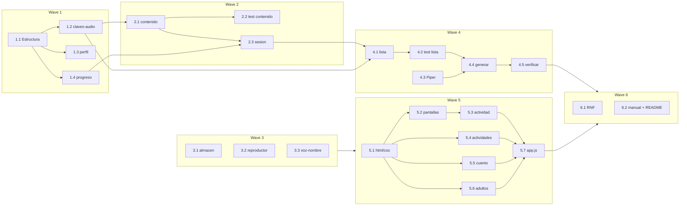

# Tareas — Juego para aprender a leer

Modo SDD: standard
Fase: Implementación
Estado: completada
Gate 3: aprobado

Convención TDD focalizado: RED (test que falla por el comportamiento) → GREEN mínimo correcto → REFACTOR solo si aporta valor. Comando: `npm test` (`node --test tests/`).

## Wave 1 — Base
- [x] 1.1 Estructura del proyecto: `package.json` (scripts `test`, `audios`, `verificar`), carpetas `js/`, `css/`, `tests/`, `tools/`, `audio/`, `.gitignore` (venv y modelos de voz) (Req 1.1)
- [x] 1.2 [P] [TDD focalizado] `dominio/claves-audio.js`: slug estable (minúsculas, sin tildes, `ñ`→`nn`, espacios→`-`) y ruta por categoría (Req 2.3, 2.6)
- [x] 1.3 [P] [TDD focalizado] `dominio/perfil.js`: validar nombre (1–20, letras con tildes/ñ y espacios) y `variante(sexo)` → m/f/n (Req 9.4, 9.5, 9.6)
- [x] 1.4 [P] [TDD focalizado] `dominio/progreso.js`: desbloqueo secuencial, estrellas por % de aciertos, máximo al repetir, `todoDesbloqueado`, total de estrellas (Req 3.4, 3.6, 5.4, 5.5, 7.3)

## Wave 2 — Contenido y sesión
- [x] 2.1 `datos/contenido.js`: ~30 niveles (vocales, 18 consonantes, palabras de 2 y 3 sílabas, frases, 3–4 cuentos con pregunta de comprensión), instrucciones y felicitaciones con variantes m/f/n, emoji por palabra (Req 3.1, 3.2, 4.7, 9.6)
- [x] 2.2 [TDD focalizado] Test de contenido: ningún nivel usa letras no presentadas; todo texto tiene clave de audio; cada nivel produce 5–8 ejercicios (Req 3.3, 8.5). RED primero con un nivel inválido de prueba.
- [x] 2.3 [TDD focalizado] `dominio/sesion.js`: crear ejercicios por tipo con rng inyectable, opciones 2–4 que incluyen el objetivo, pista tras 2 fallos, conteo de aciertos al primer intento, fin de sesión (Req 4.1–4.5, 5.2, 5.3, 8.5)

## Wave 3 — Infraestructura
- [x] 3.1 [P] [TDD focalizado] `infra/almacen.js`: clave `leer.v1`, `cargar()` → `Result` (dañado/ausente/versión desconocida → estado inicial + `console.warn`), `guardar()` tolerante a cuota llena, con `Storage` simulado (Req 6.1, 6.2, 6.3, 9.3)
- [x] 3.2 [P] `infra/reproductor.js`: un solo `Audio`, detener el anterior, promesa que resuelve en `ended`/`error`, `secuencia()`, volumen (Req 2.1, 2.6, 2.7, 7.4). Verificación manual (excepción UI).
- [x] 3.3 [P] `infra/voz-nombre.js`: `speechSynthesis` con preferencia es-MX → es-419 → es-*, no-op si no hay voz (Req 9.8, 9.9). Verificación manual.

## Wave 4 — Audios
- [x] 4.1 `tools/lista-audios.js`: contenido → lista `{texto, ruta}` sin duplicados (reutiliza `claves-audio`) (Req 2.1, 2.3, 2.4)
- [x] 4.2 [TDD focalizado] Test de `lista-audios`: incluye sílabas, palabras, frases, palabras de cuentos, instrucciones m/f/n; sin rutas duplicadas (Req 2.4, 9.6)
- [x] 4.3 Instalar Piper en `tools/.venv` con `requirements-audio.txt` fijado y descargar `es_MX-claude-high` (Req 2.4)
- [x] 4.4 `tools/generar-audios.mjs`: piper → WAV → ffmpeg MP3 mono 64 kbps, idempotente, `--forzar`; efectos sintetizados con ffmpeg (Req 2.1, 2.4, 5.1)
- [x] 4.5 `tools/verificar-audios.mjs` y ejecución completa: 0 faltantes (RNF-4)

## Wave 5 — Interfaz
- [x] 5.1 `index.html` + `css/estilos.css`: variables `--toque: 64px`, `--letra: 56px`, paleta con contraste ≥ 4.5:1, animaciones de acierto/celebración, orden de scripts clásicos (Req 1.1, 1.2, 8.1, 8.4)
- [x] 5.2 `ui/pantallas`: inicio (▶ Jugar), perfil (nombre, 👦/👧, Saltar, Listo deshabilitado si inválido), saludo, mapa (⭐, 🔒 con audio, total, ⚙️ 3 s) (Req 2.5, 3.5, 5.5, 7.1, 9.1, 9.2, 9.5, 9.7, 9.10, 9.11)
- [x] 5.3 `ui/pantallas/actividad.js` y celebración: 🏠, 🔊, puntos de progreso, feedback correcto/«¡Casi!», pista, estrellas con nombre escrito y hablado (Req 2.1, 2.2, 5.1–5.4, 8.3, 9.7, 9.8)
- [x] 5.4 [P] `ui/actividades`: escucha-elige, carretilla, une-letras (Pointer Events arrastre + toque-toque), arma-palabra, lee-elige (Req 2.3, 4.1–4.5, 8.2)
- [x] 5.5 [P] `ui/actividades/cuento.js`: páginas, lectura palabra a palabra con resaltado, tocar palabra, «escuchar todo», pregunta de comprensión (Req 4.6, 4.7)
- [x] 5.6 [P] `ui/pantallas/adultos.js`: reiniciar con confirmación, desbloquear todo, volumen, editar/borrar perfil (Req 7.2–7.5)
- [x] 5.7 `js/app.js`: composition root (instancia almacén, reproductor, voz; inyecta en pantallas) y enrutado (Req 6.2, 9.11)

## Wave 6 — Verificación previa al cierre
- [x] 6.1 Checks RNF: `rg "https?://"` en juego = 0; `localStorage` solo en `infra/almacen.js`; `innerHTML` sin datos variables; peso < 20 MB (RNF-1, 2, 3, 5, 6; Req 1.3)
- [x] 6.2 Lista de pruebas manuales (Chrome y Safari, escritorio y tablet, abierto con `file://` sin red) y `README.md` breve de uso y regeneración de audios (Req 1.1, 1.2, 8.2)

- [omitido: PBT — sin invariante algebraico que justifique una librería]

## Grafo de waves

Wave 4 (audios) y Wave 5 (interfaz) pueden avanzar en paralelo tras Wave 2; la interfaz tolera audios faltantes (Req 2.6).
